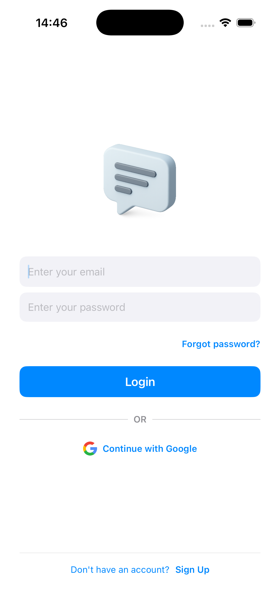
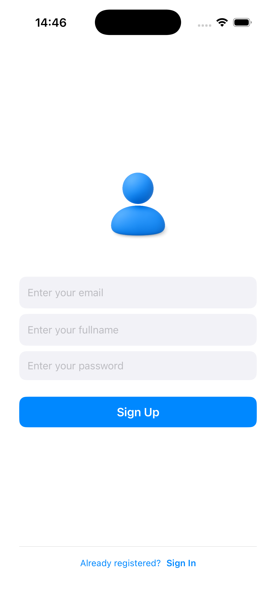
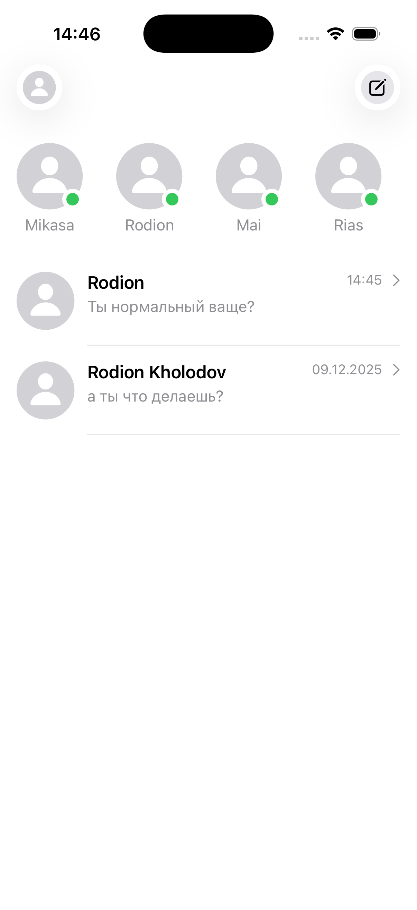
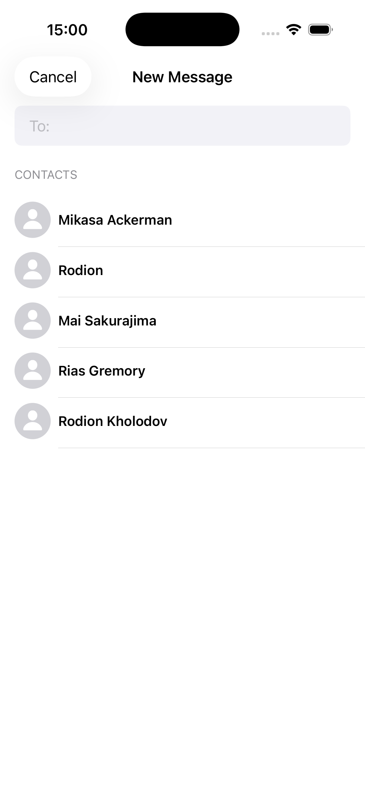
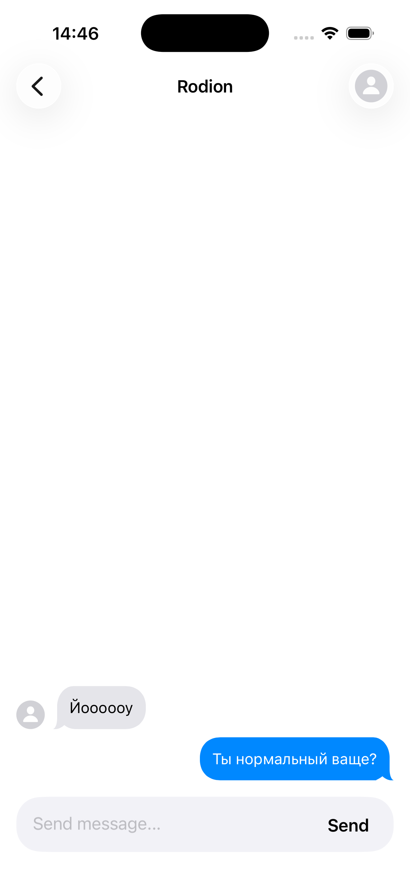
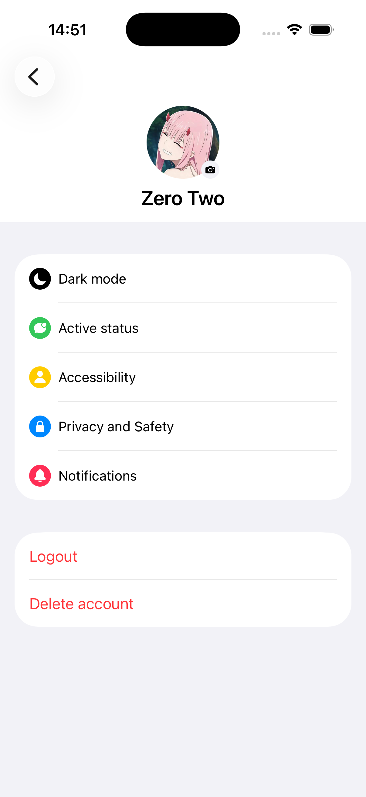

# MessengerApp

iOS-мессенджер на SwiftUI с регистрацией, личными чатами и обновлением сообщений в реальном времени. Проект построен на MVVM с координаторами. Для разработки настроены unit- и snapshot-тесты, проверки стиля, Fastlane и CI в GitHub Actions с отчётом покрытия в pull request.

## Скриншоты

<table>
  <tr>
    <th>Вход</th>
    <th>Регистрация</th>
    <th>Список чатов</th>
  </tr>
  <tr>
    <td></td>
    <td></td>
    <td></td>
  </tr>
</table>

<table>
  <tr>
    <th>Новое сообщение</th>
    <th>Переписка</th>
    <th>Профиль</th>
  </tr>
  <tr>
    <td></td>
    <td></td>
    <td></td>
  </tr>
</table>

## Возможности

- Регистрация и вход по email и паролю.
- Сохранение сессии и автоматическое переключение между авторизацией и основными экранами.
- Выбор собеседника из списка зарегистрированных пользователей.
- Отправка и получение текстовых сообщений в реальном времени.
- Список диалогов с последним сообщением, временем отправки и сортировкой по дате.
- Просмотр профиля и выбор аватара из фототеки через PhotosPicker.
- Выход из аккаунта и удаление учётной записи.

### Текущие ограничения

Некоторые элементы на скриншотах пока служат заготовками интерфейса:

- Вход через Google и восстановление пароля ещё не подключены.
- Пункты Dark mode, Active status, Accessibility, Privacy and Safety и Notifications пока не открывают настройки.

## Технологии

| Область | Используется |
| --- | --- |
| Интерфейс | SwiftUI, PhotosUI |
| Архитектура | MVVM, Coordinator, NavigationStack |
| Состояние и асинхронность | Combine, async/await |
| Backend | Firebase Authentication, Cloud Firestore |
| Зависимости | Swift Package Manager |
| Тестирование | XCTest, SnapshotTesting |
| Качество кода | SwiftLint, SwiftFormat |
| Автоматизация | Fastlane, GitHub Actions |

## Архитектура и структура

`View` отображает состояние `ViewModel` и передаёт действия пользователя. Модели представления обращаются к сервисам Firebase, а переходы передают координаторам через замыкания. `AppCoordinator` подписывается на изменения сессии через `AuthServiceProtocol` и выбирает поток авторизации или основной поток приложения.

```text
MessengerApp/
├── App/                 # Точка входа и настройка Firebase
├── Assets.xcassets/     # Изображения и цвета
├── Core/
│   ├── Auth/            # Вход, регистрация и сервис авторизации
│   ├── Chat/            # Переписка, сообщения и ChatService
│   ├── Components/      # Общие UI-компоненты
│   ├── Inbox/           # Список диалогов и лента пользователей
│   ├── NewMessageView/  # Выбор собеседника
│   └── Profile/         # Профиль и выбор аватара
├── Extension/           # Работа с датами и клавиатурой
├── Model/               # Модели данных
├── Navigation/          # AppCoordinator, AuthCoordinator, MainCoordinator
├── Service/             # UserService и конфигурация Firebase
└── Utils/               # Ссылки на коллекции Firestore
MessengerAppTests/
├── UnitTests/           # Тесты координаторов и загрузки фото профиля
└── SnapshotTests/       # Снимки экранов входа и регистрации
Fastlane/                # Линтинг, тесты и извлечение покрытия
.github/workflows/       # CI для pull request в main
docs/screenshots/         # Скриншоты для README
```

## CI и инфраструктура разработки

Проверки автоматизированы через **GitHub Actions и Fastlane**. Локально и в CI используются одни и те же Fastlane lanes для проверки кода, запуска тестов и извлечения покрытия.

### Pipeline в GitHub Actions

Workflow [Pull Request](.github/workflows/pullRequest.yml) запускается для pull request в `main` и вручную через `workflow_dispatch`.

| Этап | Что настроено |
| --- | --- |
| Подготовка | Checkout репозитория и отмена предыдущих запусков workflow через `cancel-workflow-action` |
| Окружение | `macos-latest`, Xcode 16.3, Ruby 3.3.1, Bundler 2.7.2 |
| Зависимости | `bundle install --jobs=4 --retry=3`; Swift-пакеты подключены через SPM |
| Кэш | `DerivedData/SourcePackages` и `DerivedData/Build/Products` через `actions/cache` |
| Стиль кода | Установка SwiftLint и SwiftFormat, затем запуск lane `lint` |
| Тесты | Lane `tests`: запуск через `scan` на iPhone 16 Pro с iOS 18.4 |
| Покрытие | Lane `coverage_extract`: чтение `.xcresult` через `xcrun xccov` |
| Обратная связь | Сравнение покрытия с порогом и создание или обновление комментария в PR через GitHub CLI |

Этапы выполняются последовательно: ошибка линтинга или тестов останавливает дальнейшие проверки. Для получения build settings задан таймаут `FASTLANE_XCODEBUILD_SETTINGS_TIMEOUT=120`.

### Отчёт покрытия в pull request

После тестов lane `coverage_extract` находит `.xcresult` в `test_output/`, извлекает покрытие target `MessengerApp.app` и сохраняет в `coverage.txt` процент покрытия и число покрытых строк.

Порог задаётся переменной `COVERAGE_THRESHOLD` и сейчас равен **10%**. При значении ниже порога CI выводит предупреждение в комментарии к PR; само снижение покрытия не завершает job с ошибкой.

Для отчёта используется маркер `<!-- coverage-report-comment -->`: при повторном запуске существующий комментарий обновляется. В нём отображаются статус проверки, порог, текущий процент и количество покрытых строк. Workflow имеет права `contents: read` и `pull-requests: write`, а GitHub CLI использует `GITHUB_TOKEN`.

### Fastlane

Конфигурация хранится в [Fastfile](Fastlane/Fastfile) и [Scanfile](Fastlane/Scanfile). Ruby-зависимости описаны в `Gemfile` и `Gemfile.lock`; SwiftFormat подключён через `fastlane-plugin-swiftformat`.

| Lane | Назначение |
| --- | --- |
| `lint` | SwiftLint в строгом режиме и SwiftFormat в режиме проверки без изменения файлов |
| `tests` | Запуск тестов через `scan`; принимает параметры `clean` и `skip_package_dependencies_resolution` |
| `coverage_extract` | Извлечение покрытия приложения из `.xcresult`, вывод в консоль и запись в `coverage.txt` |

В `Scanfile` включены сбор покрытия, формирование result bundle, предварительный запуск симулятора и параллельная сборка targets. Для сборки используется `DerivedData/`, для результатов — `test_output/`.

## Тестирование

### Unit-тесты

В проекте **13 unit-тестов** на XCTest, проверяющих навигацию и загрузку изображения профиля:

| Набор | Проверяемые сценарии |
| --- | --- |
| `AppCoordinatorTests` | Переключение между авторизацией и основным потоком при входе и выходе |
| `AuthCoordinatorTests` | Переход к регистрации и возврат на экран входа |
| `MainCoordinatorTests` | Открытие профиля и чата, показ и закрытие нового сообщения, переход из выбора контакта в чат |
| `ProfileViewModelTests` | Успешная загрузка изображения, отсутствие данных, ошибка загрузчика и публикация результата на главном потоке |

Для управления сессией в тестах используется `MockAuthService`, реализующий `AuthServiceProtocol` и публикующий состояние через `CurrentValueSubject`. Загрузка изображения проверяется через `MockImageLoader`: он позволяет подставить данные или ошибку. Асинхронные изменения состояния проверяются с помощью Combine-подписок и XCTest expectations.

### Snapshot-тесты

Для экранов **LoginView и RegisterView** написаны **24 snapshot-теста** на SnapshotTesting. Они сравнивают отрисованный интерфейс с эталонными PNG из `__Snapshots__/`.

| Параметр | Варианты |
| --- | --- |
| Размер экрана | iPhone 16 Pro — 402 × 874 pt; iPhone SE 3 — 375 × 667 pt |
| Тема | Светлая и тёмная при стандартном размере текста |
| Dynamic Type | Extra Large, Extra Extra Extra Large, Accessibility Extra Large, Accessibility Extra Extra Extra Large в светлой теме |

Общий `BaseSnapshotTest<Content>` создаёт `UIHostingController`, задаёт размеры экрана, тему и размер текста, выполняет layout и сравнивает результат через `assertSnapshot`. Размеры устройств вынесены в расширение `ViewImageConfig`. Запись эталонов по умолчанию отключена: `isRecord = false`.

### Проверки стиля

- **SwiftLint** проверяет код приложения и тестов. В `.swiftlint.yml` включены дополнительные правила `empty_count` и `explicit_init`, отключены `line_length` и `trailing_whitespace`; эталоны snapshot-тестов исключены из проверки. В Fastlane включён `strict: true`, поэтому предупреждения также приводят к ошибке проверки.
- **SwiftFormat** использует `.swiftformat`: отступ в четыре пробела, удаление пробелов в конце строк и единые правила переноса аргументов, параметров и коллекций. Каталоги `Build` и `DerivedData` исключены.

## Локальный запуск

Откройте `MessengerApp.xcodeproj`, дождитесь загрузки SPM-зависимостей, выберите схему `MessengerApp` и запустите приложение через **Run** (`⌘R`). Deployment target приложения — iOS 16.3.

Для запуска проверок из корня репозитория установите Ruby-зависимости и линтеры:

```sh
bundle install
brew install swiftlint swiftformat
```

Затем выполните нужные проверки:

```sh
bundle exec fastlane ios lint
bundle exec fastlane ios tests
bundle exec fastlane ios coverage_extract
```

Команда `coverage_extract` выполняется после тестов, когда создан `.xcresult`. Для Fastlane нужен симулятор **iPhone 16 Pro с iOS 18.4**, указанный в `Fastlane/Scanfile`. Тесты также можно запускать в Xcode через **Test** (`⌘U`). Для сравнения snapshot-тестов используйте одинаковую версию iOS.
